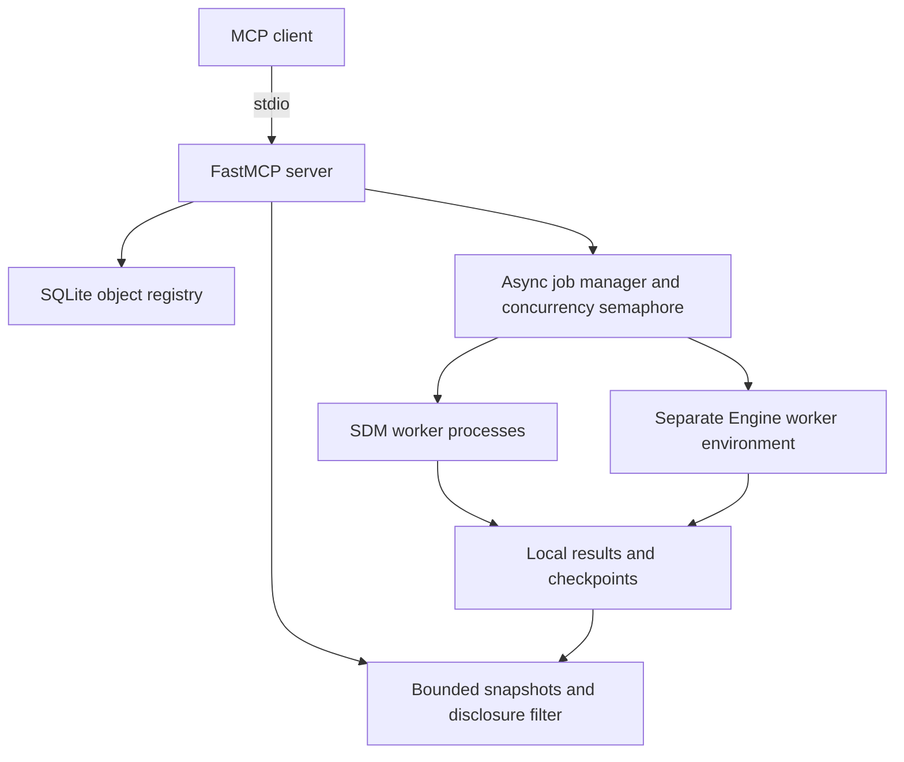

# Architecture

The server imports pandas and the MCP SDK, but never torch, SDM, or Engine. Private workers accept
line-delimited JSON operation descriptors over pipes. There is no assistant-selectable executable,
shell command, module, callback, or connector URI. The executable comes exclusively from local setup
configuration. Each worker's OS stdout descriptor is redirected to stderr before importing heavy
libraries; a duplicate descriptor carries only protocol responses.

`Config` defines roots, output directory, enabled backends, per-backend interpreter, device, input
limits, queue limits, execution timeout, idle TTL, disclosure flags, and weight-download policy.
Workers inherit a small allowlist of ordinary process variables; application tokens and database
credentials are not forwarded. Hugging Face telemetry is disabled and offline mode is explicit.

`DataManager` copies registered datasets into private storage, hashes them, records schema and
validates the hash before subsequent use. It checks keys, referential integrity, timestamps, split
overlap, and target leakage before expensive work. CSV loading is row-bounded; Parquet row metadata
is checked before collection. This version supports local files only.

`Store` persists Dataset, Schema, Job, Result, Checkpoint, Graph, Snapshot, and Session descriptors.
SQLite updates are protected by a reentrant lock. The server output-directory lock prevents two
servers from recovering the same job records simultaneously. Config and result JSON writes use
fsync plus atomic replacement. Model artifacts stay local; only explicitly permitted, bounded
dataset/result previews can travel through MCP.

`JobManager` uses async tasks and a semaphore to bound heavy execution. It keeps a mutex per worker,
terminates worker process groups on cancellation/timeouts, and unloads idle processes. Session IDs
select dedicated worker caches; the session's original settings are checked before reuse. Persistent
records cannot restore loaded tensors: session IDs expire at restart. Stale running jobs become
interrupted, and clients explicitly resubmit them.

`worker` adapts the documented SDM APIs, preserves class probability/quantile columns, and writes
predictions plus local reports. Model caches are keyed by family, settings, device, and checkpoint.
Checkpoints use safetensors for SDM; only locally produced checkpoint IDs can be loaded. Fine-tuning
selects the best validation checkpoint, including the pretrained baseline, while sampling disjoint
training context/query rows. Anomaly evaluation without labels makes no accuracy claim.

`engine` reconstructs graphs from frozen registered sources and reuses Engine's versioned snapshot
cache. PQL is handled by the Engine parser, never translated into arbitrary SQL or Python. Local
Engine training exports checkpoint bundles under the configured output root. The adapter is
experimental and checks audited public knobs before training.

An optional locally configured Docker image hosts the Linux x86-64 Engine worker on macOS. Each
worker owns a uniquely named container; cancellation removes that container before terminating its
CLI process. The runtime uses no network, a read-only root filesystem, a temporary `/tmp`, and mounts
only the worker package and output root. The image derives a provenance-recorded CPU dependency
variant without changing upstream Engine code. It is a separate runtime artifact, never part of the
Python package distribution. Graph foreign keys must reference the configured destination primary
key. Training exposes bounded epoch, experiment, training-step, evaluation-step, and refit settings.

The server creates two resource templates that render the same filtered result view as tools.
Internal report/metadata JSON is intentionally richer for local reproducibility and is not exposed
as a raw resource. Samples require independent permission from column names and summaries.

## Operational boundaries

- Backend capabilities are discovered by importing installed public classes, not inferred solely
  from installed distribution metadata. Import success is not an inference-quality claim.
- Third-party workers run as the same OS user; process isolation is not an adversarial sandbox.
- Local artifacts can consume substantial disk; there is no automatic deletion policy in v0.1.
- A local same-user attacker who can replace configuration or registry files is outside the file
  access boundary. The root checks govern assistant-originated file arguments.
- Only SDM 0.3's unified four-family API is targeted. Kumo-TS legacy environments and hosted NIM
  clients require separate adapters and are not silently substituted.
- Forecast and Anomaly fine-tuning are experimental and check objective gradients at runtime.
  Forecast defaults to adapting its head and cross-channel layers; full encoder training is opt-in.
  Temporal native SDM relational filtering, database connectors, Engine explanations, and SDM MPS
  are explicitly unsupported in this release.
